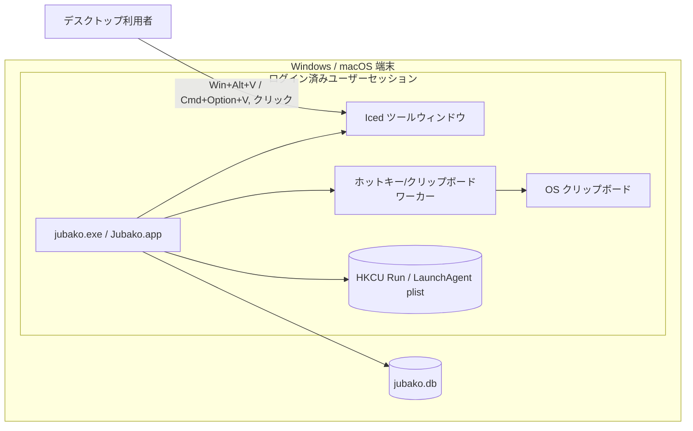

# デプロイメント

## 目的

Jubako の実行配置、依存するローカルリソース、Windows / macOS ワークステーション上での実行境界を整理します。

## トポロジ

## 実行環境

| ノード | 実行環境 | 領域/ゾーン | スケーリング | オーナー |
| --- | --- | --- | --- | --- |
| `jubako.exe` / `Jubako.app` プロセス | Rust ネイティブバイナリ（`edition=2021`） | ローカルユーザーセッション | 常駐 1 プロセス（Windows は起動時に同名既存プロセスを終了） | デスクトップアプリ開発者 |
| Iced UI ウィンドウ | `iced` イベントループ | 同一プロセス・同一セッション | 非表示/表示を切り替える単一ウィンドウ | デスクトップアプリ開発者 |
| クリップボード/ホットキーワーカー | Tokio タスク + OS イベント/ポーリングスレッド | 同一プロセス・同一セッション | Windows: イベント駆動 / macOS: 250ms 変更検知 | デスクトップアプリ開発者 |
| SQLite DB ファイル | `rusqlite`（WAL モード） | ローカルアプリデータディレクトリ | プロセス内 Mutex による単一書き込み | デスクトップアプリ開発者 |

## DB 配置パス

- **Windows**: `%APPDATA%\jubako\Jubako\data\jubako.db`（`directories::ProjectDirs` 準拠）
- **macOS**: `~/Library/Application Support/com.jubako.Jubako/jubako.db`

## ネットワーク境界

- すべての構成要素は単一端末内で動作し、待受ソケットやサービス間通信はありません。
- 信頼境界は OS ユーザーセッションで、クリップボード/ホットキー/自動起動設定は当該ユーザー文脈に限定されます。
- 保存データ境界は `jubako.db` を保持するローカルプロファイルディレクトリです。

## セキュリティと運用メモ

- **Windows**: スタートアップ永続化は `HKCU\Software\Microsoft\Windows\CurrentVersion\Run` に設定され、`--no-autostart` で無効化できます。既定では `--background` で分離起動します。
- **macOS**: `~/Applications/Jubako.app`（`Info.plist` に `LSUIElement = true`）を `~/Library/LaunchAgents/com.jubako.app.plist` から起動することで Dock 非表示・ログイン時自動起動を実現します。自動ペーストには「システム設定 → プライバシーとセキュリティ → アクセシビリティ」の許可が必要です。
- SQLite は WAL と外部キーを有効化しており、ローカル書き込みの耐障害性を高めています。
- 現状の運用ログは標準エラー出力のみで、集中監視向けテレメトリは未実装です。
