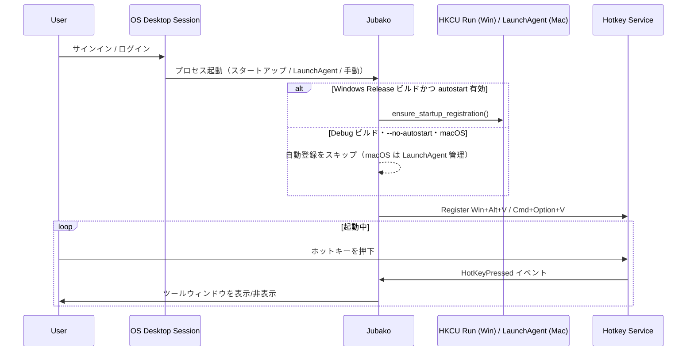

# 認証とセッショントラスト

## 目的

Jubako が Windows / macOS ユーザーセッション上でどのように信頼され、起動されるかを示します。なお、アプリ独自ログインは存在しません。

## 前提条件

- デスクトップセッションにユーザーがログイン済みであること。
- Windows: `jubako.exe` が配置され、必要に応じて `--no-autostart` なしで起動しスタートアップ登録が有効であること。
- macOS: `Jubako.app`（`LSUIElement = true`）および LaunchAgent（`~/Library/LaunchAgents/com.jubako.app.plist`）が構成され、アクセシビリティ権限が付与されていること。

## シーケンス

## 異常系

- Windows でレジストリ書き込み失敗時はエラーログを出し、スタートアップ永続化なしで継続します。
- ホットキー登録失敗時は現行実装（`expect`）で起動時 panic となり、ポップアップは利用できません。
- Windows でバックグラウンド分離起動に失敗した場合はフォアグラウンド動作へフォールバックします。
- macOS でアクセシビリティ権限が未許可の場合、ウィンドウ表示は動作しますが自動ペースト（`osascript`）が失敗します。

## メモ

- 認証はアプリ内 ID 基盤ではなく、OS アカウント/セッション制御に依存します。
- セキュリティ水準は端末アカウント運用と OS ロック・TCC（アクセシビリティ）ポリシーに左右されます。
